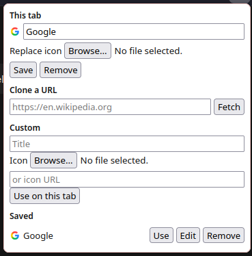
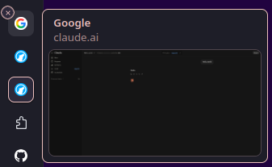

# tab-cloak

This extension hides the true favicon and title of a Firefox tab. It allows you to either clone the favicon and title from an existing website or to use custom ones.

## screenshots

Created by Grok 4.7 in Build mode and a bit of Claude Sonnet 5.5.
